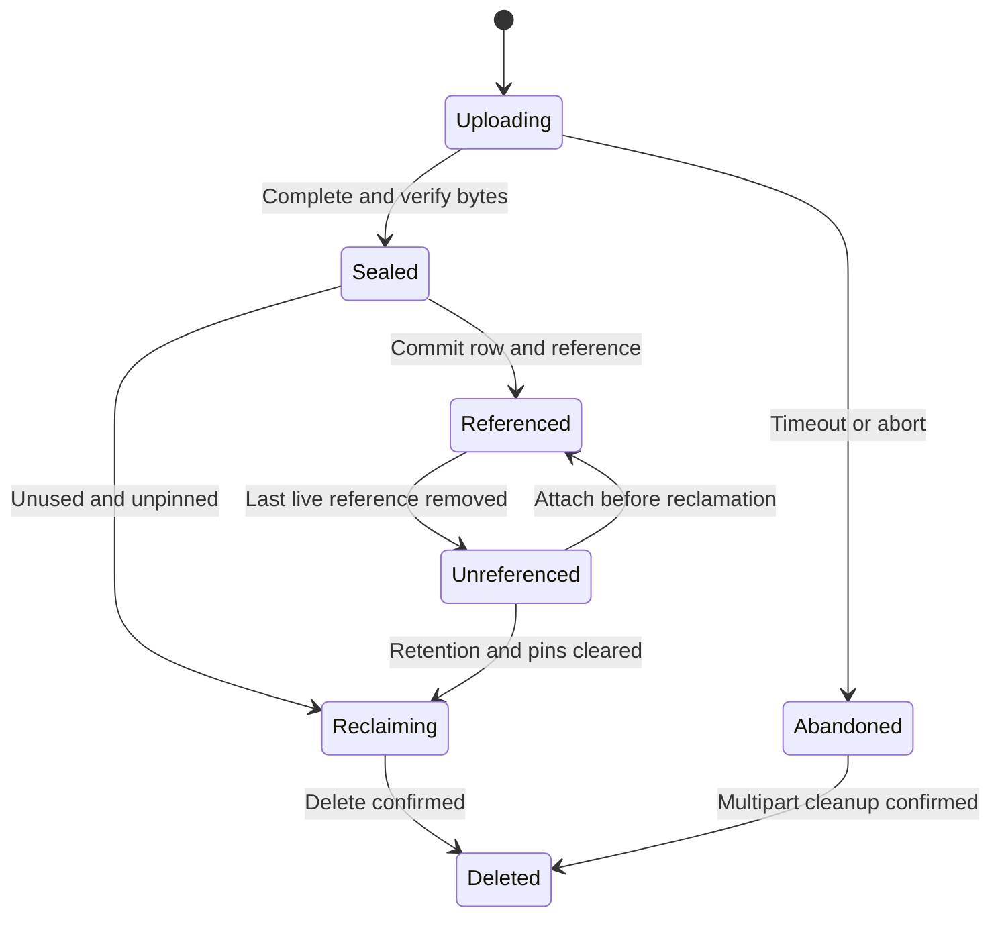

# Administration, geospatial and large-object contracts

These are proposed API shapes, not implemented endpoints. Example identifiers are placeholders. Falcone gateway routes may prefix the standalone paths shown here.

## SQL-free administration

Use **REST/JSON over HTTPS** externally and **gRPC/Protobuf** for internal service communication. Publish OpenAPI/JSON Schema and Protobuf contracts from a common typed model, with equivalence tests for naming, defaults, error semantics, timestamps, 64-bit integers and decimal strings. Do not assume automatic transcoding handles all semantics correctly.

SQL remains available for application queries and compatible schema operations; administration must not require SQL knowledge. REST and SQL DDL feed the same catalog command implementation, policy checks and durable job state.

| Resource | Example operation | Behavior |
| --- | --- | --- |
| Databases/schemas/tables | `POST /v1/workspaces/{workspace}/databases/{database}/schema-plans` | Validate typed definitions and return a reviewable plan |
| Schema plans | `POST /v1/schema-plans/{id}:apply` | Apply exactly the validated plan with version/precondition checks |
| Columns/indexes/constraints | Typed changes within schema plans | Online state machine with progress and supported rollback boundary |
| Roles/policies/grants | `PUT /v1/.../policies/{id}` | Authorization and optimistic concurrency; audited changes |
| Shards/placement | `POST /v1/.../placement-plans` | Preview capacity/locality impact; schedule bounded transfers |
| Placement operations | `GET /v1/.../placement-operations/{id}` | Report split/move state, generation, affected-range pause, blockers, budgets and cancellation boundary |
| Transaction outcomes | `GET /v1/.../transaction-outcomes/{id}` | Scope-authorized resolution of known/unknown outcomes with retention/retry limits; never a cross-tenant oracle |
| Operations | `GET /v1/operations/{id}` | Queued/running/succeeded/failed/cancel-requested/cancelled with progress |
| Sessions/queries | `GET /v1/.../sessions`, `POST /v1/.../queries/{id}:cancel` | Scoped inspection; best-effort cancellation with durable transaction outcome |
| Backups/restores | `POST /v1/.../backups`, `POST /v1/.../restores` | Asynchronous, resumable, validated jobs |
| Object storage bindings | `POST /v1/.../object-stores` | Endpoint/region/bucket/secret reference; validate provider capabilities |
| Objects | `POST /v1/.../objects:beginUpload`, `POST /v1/.../objects/{id}:seal` | Multipart lifecycle with integrity verification |
| Observability | `GET /v1/.../statistics`, `POST /v1/.../queries:explain` | Safe plans and resource information without raw sensitive values |
| Native storage status | `GET /v1/storage-domains/{id}` | Operator-scoped format versions, WAL/checkpoint positions, file/cache/compaction metrics; no raw tenant values |
| Storage verification/maintenance | `POST /v1/storage-domains/{id}:verify`, `POST /v1/storage-domains/{id}:compact` | Budgeted resumable jobs under operator authorization; preserve snapshot/backup pins; no online destructive salvage |
| Capabilities | `GET /v1/capabilities` | Actual supported types/features/limits/version, not marketing defaults |

Administrative mutations use an idempotency key bound to principal, scope and request hash. Reusing a key with different content fails. An `If-Match`/expected resource version prevents lost updates. Preview plans bind the catalog version, principal, capability/policy version and content hash; apply reauthorizes and rejects stale plans.

The idempotency record and effect share durable transactional authority. Publish the retention window, maximum safe retry horizon and expired-key behavior; do not execute an uncertain old request solely because its outcome was reclaimed. Resource limits and deadlines follow requests across internal retries. Use decimal strings for exact int64/decimal values in JSON where numeric transport cannot preserve them; distinguish omitted, null and default values. Mixed-version clients must preserve supported unknown optional data on rewrite or receive an explicit incompatibility error.

Native storage reports its owned format major/minor/features and compatible reader/writer versions. Operator file-verification controls are distinct from tenant query permissions. The storage API never allows a caller to bypass WAL durability, overwrite a live file, remove a pin or force-drop protected history. Format conversion is a separately preflighted upgrade job; physical byte inspection/salvage follows the offline tools contract in [native storage](native-storage.md).

Return `202` plus an operation ID for long jobs. Cancellation does not promise rollback after a commit point. Errors contain stable code, retryability, request ID, violations and current version where safe. Never report a job complete merely because it was accepted by a worker.

Example schema plan:

```json
{
  "expectedCatalogVersion": "42",
  "changes": [
    {
      "kind": "createTable",
      "schema": "public",
      "name": "assets",
      "columns": [
        {"name": "id", "type": {"name": "uuid"}, "nullable": false},
        {"name": "location", "type": {"name": "geography", "shape": "Point", "srid": 4326}},
        {"name": "file", "type": {"name": "object_ref", "store": "workspace-files"}},
        {"name": "metadata", "type": {"name": "json"}}
      ],
      "primaryKey": ["id"],
      "distribution": {"strategy": "hash", "columns": ["id"]},
      "indexes": [
        {"name": "assets_location", "method": "spatial", "columns": ["location"]}
      ]
    }
  ]
}
```

Tenant/workspace authority is derived from authenticated context and the authorized path, never the body. Replication factor and node placement are operator capabilities rather than arbitrary application input.

Initial internal service contracts: `CatalogService`, `TransactionService`, `ShardService`, `PlacementService`, `ObjectService`, `ChangeStreamService`, `BackupService`. Requests carry authenticated scope, request/transaction ID, deadline, resource budgets, schema/shard epochs and trace context. Clients cannot forge internal identity fields. Streams implement flow control, cancellation, resumable tokens where meaningful, and bounded messages. Reserve Protobuf field numbers when removing fields.

## DDL and catalog consistency

For large changes use explicit states: `VALIDATING → WRITE_ONLY → BACKFILLING → VALIDATING_DATA → PUBLIC`, or a terminal failure state. Not every schema mutation needs every stage.

An index backfill starts at a protected MVCC timestamp while concurrent writes maintain the new index under a schema lease/version. Validate uniqueness before publication. Query workers plan against compatible catalog versions; publication is atomic. Dropping a column/index hides it before reclaiming physical state. Rollback after publication is a new forward operation unless a safe inverse is defined.

Small supported DDL can be transactional. Long-running online jobs are not falsely presented as one ordinary user transaction. Declare which DDL forms are allowed inside `BEGIN/COMMIT`; reject unsupported combinations.

Backfill uses the required consistent-cut/retention protocol from [distributed contracts](distributed-contracts.md#consistent-cuts-for-backup-backfill-and-streams). Versioned descriptor leases bound old-plan lifetimes; publication waits for required write behavior, and reclamation waits for old readers. Test DDL concurrently with shard cutover, backfill cancellation and writer upgrades. Runtime capability discovery reflects this exact supported intersection.

JSON/gRPC administration and minimal recovery/diagnostic tooling are core. E09-S04's polished Falcone console and general-purpose CLI are P2 presentation work; postponing them does not postpone the APIs or operational runbooks.

## Geospatial subset

Use PostGIS as a behavioral reference for a declared subset, not as a required PostgreSQL extension. GeoRust is a candidate implementation library; see [research](research.md), S23/S24/S31.

| Capability | M3 baseline | Later |
| --- | --- | --- |
| Planar types | Point, LineString, Polygon and Multi variants; GeometryCollection only when tested | Curves, advanced 3D/topology |
| Earth coordinates | `geography(Point, 4326)` with documented spheroidal distance/radius semantics | Broader geography polygon operations after robust geodesic validation |
| Formats | GeoJSON, WKT, WKB; SRID stored explicitly | More GIS interchange formats |
| Functions | Geometry: intersects, contains, within, bounding box, distance; geography points: distance/within-radius | Buffer/overlay, transforms, spatial joins and exact KNN expansion |
| Index | Persistent MVCC-aware bounding/cell candidate index with exact predicate recheck | Additional R-tree/cell layouts after benchmarks |
| Coordinate systems | Planar operations in an explicit SRID; EPSG:4326 longitude/latitude for geography | PROJ-backed transforms with pinned grid data and reproducible semantics |

Proposed internal index uses a bounded multiresolution cell covering serialized into ordered keys, plus row/version references. It must be conservative: false positives are acceptable before exact recheck; false negatives are not. Large polygons need a bounded coarse-cell/overflow representation. Cell encoding and algorithm selection are M0/E10 decisions; a full table scan remains the correctness fallback. Avoid claiming that an in-memory Rust R-tree is a crash-safe distributed index.

Spatial writes update row and index in the same transaction. Optimizer pushdown and shard pruning must preserve scope and geometry semantics. Test boundaries, empty/invalid geometries, holes, self-intersections, antimeridian, poles, axis order, mixed SRIDs and floating-point tolerance. Invalid inputs are rejected or explicitly repaired on request; no silent repair. Geography distance is in meters, not degrees; planar distance follows the CRS units. A whole-table spatial query may still contact many shards.

The API should expose the same supported operations as SQL. Example typed filter: `{"operator":"within_distance","column":"location","point":{"longitude":-3.7038,"latitude":40.4168,"srid":4326},"distanceMeters":1000}`. Do not promise arbitrary PostGIS functions, raster or 3D in the initial release.

## Native S3 object type

Separate three uses of S3:

1. **Managed large objects — M3 required:** bytes outside the row engine, references and lifecycle inside it.
2. **Backups and archived transaction history — M3 required:** protected manifests and verified restore.
3. **Cold table storage / Parquet queries — M5:** separate execution/consistency contract, not an accidental consequence of uploading files.

An `object_ref` is an opaque immutable object/version identity, not a URL. The catalog records scope, provider binding, key, immutable version identifier where supported, byte length, verified checksum algorithm/value, media type, encryption-key reference, lifecycle state and retention pins. Presigned URLs are generated on demand after authorization and never stored as the durable identity. Small binary values remain inline with a documented size limit; applications choose managed objects explicitly in the first version.

Object-store bindings can point to Falcone Storage or a qualified external S3-compatible endpoint. The database does not implement another object server. Managed buckets/prefixes prohibit out-of-band overwrite/deletion and incompatible lifecycle expiration. Provider capability probes cover multipart, checksum/read verification, range reads, versioning or immutable-key discipline, conditional writes, credential rotation and error behavior. AWS guarantees are not automatically assumed for every compatible product.

Lifecycle:



Upload protocol:

1. Begin an upload under scope/quota and return bounded-lifetime credentials or presigned part URLs. Reserve logical capacity to avoid unlimited abandoned uploads.
2. Client streams bytes directly to S3; database nodes do not buffer whole files.
3. Complete upload and verify immutable identity, size and checksum. S3 multipart ETag is not a general content MD5; use a specified checksum or a streaming verification pass [S33–S34 in research].
4. Mark object `SEALED` only after verification. A row transaction may attach only a sealed object of the same authorized scope. Commit the row and reference record atomically inside Falcone RDBMS.
5. Aborted row transactions leave an unreferenced sealed object for later GC. Lost upload responses are reconciled idempotently by upload/object ID.

**There is no atomic transaction across arbitrary S3 and the database.** The user-visible contract is atomic publication of a database reference to a previously verified immutable object. Durability/availability of the bytes also depends on the object provider and bucket policy. A row commit does not make S3 reads available during a provider outage. Never turn an inaccessible object into a silent SQL NULL.

Updating file content creates a new immutable object and swaps the reference in a row transaction. Deletion removes the live reference but preserves versions required by active snapshots, PITR history, backups, retained CDC or legal/owner retention policy. GC obtains a catalog reclamation claim under concurrency control, prohibits new attachment after that claim, checks pins/protected epochs, and retries provider deletion idempotently. A reference counter alone is insufficient. Backup pin creation and GC claims must serialize to prevent the backup/GC race.

Backup manifests bind database snapshot timestamp, catalog version, object identities, checksums and encryption dependencies. A database-only backup is not advertised as a complete restore when object bytes are absent. By default retain protected originals plus a separately qualified backup copy/replica policy for disaster recovery. Deduplication, if added, is scoped per tenant to avoid cross-tenant existence leaks.

Download authorization checks the referring row/object policy. Short-lived presigned access has an explicit revocation window; immediate revocation requires proxy access or provider-specific controls. Upload/GET/HEAD/copy/egress costs and physical versus logical bytes are visible in quota and billing metrics.
