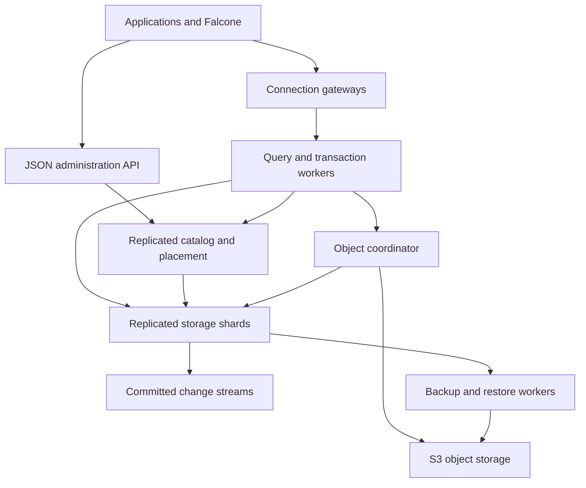

# Proposed architecture

Status: proposal; all guarantees below are implementation requirements and release gates, not current behavior. See [research](research.md) for source evidence and [roadmap](quality-and-roadmap.md) for qualification.

The 3 November [documentation review](documentation-review.md) prioritizes the essential features and maps B1–B3 to this design. The 4 November [fourth-book review](database-system-concepts-review.md) adds B4 and the [relational/data-operation contracts](relational-operations.md), including catalog dependencies, sequences, statistics, plan reuse, bulk operations and later materialized views. The [distributed contracts](distributed-contracts.md) refine the growth profiles, authority, split state machine, snapshots, retry retention and bounded query execution described here. Those refinements supersede the earlier informal split outline.

## Product boundary

Falcone RDBMS owns SQL evaluation, schema/catalog management, authorization, transactions, distributed indexes, native shard placement, replication, recovery and operational APIs. **Storage-engine and disk-format ownership is a confirmed user requirement.** Falcone implements its own persistence code in Rust: WAL, table files, manifest/checkpoints, cache, compaction, integrity verification and recovery. Third-party database/storage engines are excluded as shipping backends. Qualified general-purpose libraries and a consensus algorithm core remain eligible; Falcone owns their storage integration.

The [native storage design](native-storage.md) specifies this boundary and the proposed first-party LSM layout. Disk-format details remain an RFC until M0 evidence freezes a version; the ownership requirement is already decided.

The initial production target is transactional BaaS workloads in one region across three independent failure domains. Scale connection gateways and query workers independently of storage. S3 initially stores large objects and backups; it is not the synchronous storage path for ordinary row commits.

## Components and deployment

| Process role | Responsibilities | State and scaling |
| --- | --- | --- |
| `falcone-db-gateway` | PostgreSQL protocol, optional JSON query API, TLS/auth, session state, quotas, cancellation, admission | Ephemeral client/session state; horizontally replicated; restart can disconnect clients |
| `falcone-db-query` | Parse/bind/optimize, execute, coordinate transactions, merge results | Disposable compute; durable transaction outcome is stored elsewhere |
| `falcone-db-meta` | Cluster bootstrap, catalog epochs, shard directory, placement policies, timestamp allocation | Small Raft-replicated metadata service; three voters initially; do not send every row through it |
| `falcone-db-store` | Host many shard Raft groups, versioned rows/indexes, intents, locks, log replay, compaction | Persistent SSD/NVMe; data survives an individual member's loss under replication policy |
| `falcone-db-admin` | REST/JSON and gRPC management, schema jobs, operations/status, API authorization | Replicated front ends; durable jobs/catalog live in replicated metadata |
| `falcone-db-worker` | Blob lifecycle, backup, restore, CDC delivery, index backfill, reconciliation | Idempotent resumable tasks; separately budgeted CPU, disk and network |

Roles can share one binary in local development. Separation into independent deployments is a scaling option, not a requirement for six microservices per small workspace. Never deploy one process, Raft group or database instance per client or automatically per tenant.

Support a non-HA single-node development profile, a small three-domain production profile with one/few replicated data ranges, and a scale-out profile with many ranges. Compatible small tables/tenants can share ranges; logical distribution policy does not imply dedicated physical resources. Sharding is native from the start and used as capacity/load requires it. Prove the transition between production profiles using the same client endpoint and logical schema.

The cluster bootstraps from authenticated node membership and its own replicated metadata storage. It must not depend on a tenant database it is supposed to provision. Falcone IAM/Secrets integration has cached verification and explicit failure behavior; no request-loop dependency on this new engine is introduced into its own startup.

## Key and catalog model

Logical identity: `cluster → tenant → workspace → database → schema → table`. Stable numeric/internal IDs prevent rename operations from moving stored data. Security scope is immutable, authenticated context, not a user-controlled SQL session variable.

Conceptual row key: `(tenant_id, workspace_id, database_id, placement_group_id, distribution_value, table_id, primary_key, version)`. Actual binary encoding, field order and version ordering are frozen only after E01/E02 benchmarks. A secondary index uses its own index ID and normalized indexed values, with a row locator. All paths include security scope, including global indexes, blobs, CDC checkpoints, caches and temporary spill files.

Catalog entries include columns/types, named constraints and validation states, indexes, view definitions, sequence descriptors, dependency edges, statistics descriptors, placement, policy versions, object storage bindings, migration state and schema version. Separate the logical catalog from the physical shard directory. Cache entries are keyed by security scope and epoch, not only SQL text or table name.

Logical definitions bind stable IDs and versions, not names alone. Dependency-aware DDL defaults to RESTRICT and previews the exact authorized CASCADE closure. Initial logical views are read-only with invoker/base-object permissions and RLS; definer-rights and view updates are separate compatibility gates. E24 provides these details beneath E03/E05/E09.

Sequence allocation uses durable disjoint ranges from per-sequence replicated authority, with fenced holder generations and explicit gaps/overflow/restore behavior. It is not a global commit clock or gap-free business numbering. Actual row values are resolved before deterministic replication. See the [identity contract](relational-operations.md#identity-and-sequence-allocation).

## Persistence and consensus

Use Falcone's first-party storage engine with a bounded number of storage domains per process, rather than allocating a complete engine per tiny tenant or shard. The initial design is an LSM with ordered memtables, immutable sorted table blocks, a versioned manifest, WAL, Bloom filters and a block cache. Prefixes identify logical shards; immutable output files remain within a shard/key-range boundary to simplify movement and snapshots. Domains share bounded pools for memtables/cache/compaction without giving every shard a fixed large allocation. Measure the fairness cost of shared storage and offer dedicated node pools for large tenants.

Falcone defines and maintains the file format and logical key encoding. It does not reuse RocksDB SST/WAL formats or require its libraries. M0 compares the first-party LSM prototype with a small first-party B+tree prototype on representative workloads; changing the layout does not relax ownership.

Each shard is a Raft replication group, normally three voters on three distinct hosts/failure domains. A majority is required for writes. Membership changes use a qualified joint-consensus/learner procedure; a routing epoch alone is not a substitute for consensus fencing. Replicas also serve checksum audits and snapshot recovery.

Durability contract:

1. A shard leader proposes deterministic commands, never reevaluating nondeterministic SQL independently on replicas.
2. Required log entries are durably persisted on a quorum before commit acknowledgement.
3. Applying a command changes row/index/intent state and its applied-log index atomically through Falcone's own bounded `ApplyBatch` and engine WAL. Local engine sequence numbers, Raft indexes and SQL transaction timestamps are distinct coordinates.
4. Replay after a crash is idempotent. A snapshot contains its exact shard descriptor, schema dependencies, transaction state and applied index.
5. Log truncation happens only after a durable recoverable checkpoint and all applicable replication/backup/CDC obligations permit it. The initial design keeps separate first-party consensus and engine WAL streams with explicit replay fences. Removing duplicate persistence requires a later protocol design and crash-test evidence, not disabling a WAL by configuration.

Use MVCC versions for consistent historical reads, backups and recovery. Track active transactions, protected snapshot timestamps, backups and CDC retention before collecting old versions. Long-lived snapshots have explicit limits; storage exhaustion must throttle/reject work before corrupting durability.

## Distributed transaction protocol

**Serializable is the proposed default.** Consensus, MVCC and two-phase commit alone do not prove serializability. The initial correctness-first protocol is strict two-phase locking of read/write keys and predicates, layered over MVCC, with replicated transaction status and two-phase commit for multiple shards. Read-committed/snapshot modes are deferred until separately specified and tested.

Transactions are identified by a stable ID and attempt/ownership epoch. A hashed transaction-status key distributes decision records across system shards. The status record includes participants, deadline, state, coordinator fencing epoch, and the immutable final decision. Freeze participant membership before committing; late participants force a valid protocol transition or abort. An HA timestamp allocator initially colocated with metadata allocates monotone epochs/timestamps for MVCC; batching and failover must preserve dependencies and account for unused reservations. Catalog, placement, allocation and resolution use separate budgeted queues. Allocation is a benchmarked potential bottleneck, not an assumed infinitely scalable service or a global snapshot proof.

The initial read/write transaction algorithm locks the accessed keys and index ranges, reads the latest committed version under those locks, and holds locks through final decision. Predicate protection includes absent keys, secondary-index gaps, full scans, and constraint checks. Fall back to a modeled coarse table/index protection when a precise range cannot be derived. Coarse and fine locks share an explicit intention/coverage hierarchy; table-wide protection spans the necessary shard participants. Escalation acquires covering protection before releasing fine locks and cannot abandon prepared promises. This must not require a central catalog/root-lock RPC per row. Retrying a transaction must not reuse stale reads. Do not mix arbitrary snapshot reads into this algorithm and assume serializability remains intact.

Single-shard transactions use a one-phase path where all writes, constraints and the decision can be replicated atomically in that group. If an operation adds a participant, use the distributed path before committing.

For multiple shards:

1. Record participant membership under a fenced coordinator epoch. Obtain shared/exclusive key and predicate locks, then validate constraints under the same transaction.
2. Prepare each participant: replicate write intents and enough lock/transaction recovery state to survive leader loss. Participants promise not to commit or release prepared state independently.
3. After every participant has prepared, allocate a commit timestamp consistent with observed dependencies and persist `COMMITTED` in the transaction-status quorum. Otherwise persist `ABORTED` through the valid decision authority.
4. Apply the decision to participants idempotently. Reads encountering unresolved intents consult the authoritative decision or wait; they never expose a partially committed multi-shard transaction.
5. Acknowledge success after the durable decision and required participant prepare durability establish recoverability. Asynchronous cleanup must not alter the outcome.

If a response is lost, return/resolve an **unknown outcome** using the transaction/request ID. Persist eligible idempotency keys, scope, operation/payload hash and outcome under the same decision authority as their effects. Define a retention/retry horizon; an expired or unknown ID does not prove noncommit. Do not report failure as proof that a transaction did not commit. Never retry arbitrary user transactions silently: nondeterministic values and external side effects matter. Allow bounded transparent retries only for explicitly safe operations before returning visible results, with an end-to-end deadline and retry budget.

Leader failover reconstructs prepared locks before serving conflicting work; unprepared attempts must be safely fenced/aborted or recovered. Resolve deadlocks by a documented global order/victim rule and return a retryable error. Coordinator lease expiry initiates recovery; it is not permission to discard prepared locks. If the decision quorum is unavailable, affected transactions may block. This is an explicit availability tradeoff.

Consistent internal snapshots are a **required M2 primitive** for backup, backfill and snapshot-to-stream handoff: publish a stable frontier that accounts for every transaction that could still commit at/below it, lagging participants, timestamp reservations, topology and schema. Specify and model that protocol, or use an explicitly quiesced consistent checkpoint with declared availability impact. A local engine read view is insufficient. Initially ordinary serializable SQL reads use the locking path. Public snapshot/follower modes remain separately gated; route fresh reads through verified leader authority and an applied-state barrier. HLC timestamps alone do not establish serializability or external consistency. No strict-serializable/external-consistency claim is made until independently checked.

## Native sharding and placement

Every logical table has a distribution policy from creation. Start with auto-selected defaults but show them in introspection and plan previews.

Default hash placement maps canonical distribution bytes through a stable versioned hash into movable token ranges. The replicated directory maps ranges to replica sets; never use modulo the current node count. Colocation has explicit indivisible-unit limits and cannot silently prevent a large tenant from subdividing. Ordered-range policies and pre-splitting are available for suitable workloads.

| Strategy | Appropriate workload | Cost |
| --- | --- | --- |
| Hash primary/entity key | General OLTP and even write spread | Ordered scans touch several shards |
| Range key | Time/range scans, ordered workloads | Monotonic writes can create a hot tail |
| Tenant/workspace placement plus row subdivision | Shared BaaS with residency/plan isolation | Needs automatic subdivision for a large tenant |
| Colocated table group | Parent/child joins and transactions by the same entity key | Layout and key encoding must match across tables |
| Scoped reference tables | Small shared lookup data | Replication/update overhead; explicit size limits |

Do not make `hash(tenant_id)` the only partitioning rule: one tenant can exceed a node. Distinguish tenant placement from row sharding. A single very hot row is still serialized; splitting a shard cannot remove that contention.

The initial split workflow is `PLANNED → COPYING → DRAINING → SEALED → PUBLISHED → RETIRING → COMPLETE`, defined in [distributed contracts](distributed-contracts.md#initial-split-and-movement-state-machine). Precopy retains ordered deltas; a replicated source fence drains affected transactions before child activation. A measured admission pause is allowed on the affected range. Prepared transactions must resolve or block cutover; timeouts never discard them. Live lock/predicate transfer is deferred until separately proven. Replica replacement within one group uses consensus membership; distribution-key changes use an explicit migration. Stale routing cannot duplicate applied effects or reactivate the old writer.

Schedule by bytes, CPU, read/write load, compaction pressure, replica health, tenant budgets and locality. Use hysteresis and transfer budgets to avoid constant movement. Support safe manual pinning/drain in addition to automation. Initial system supports splitting and replica movement; merging ranges is a later optimization.

Unique constraints and foreign keys must remain correct across shards. Local unique indexes suffice only when the distribution key makes uniqueness local. Otherwise use a transactional global index keyed by `(scope, index_id, normalized_value)` and include it as a participant. FK existence/deletion checks lock referenced keys; cascades need bounded size and all-or-nothing behavior. Unsupported distributed constraints are rejected at DDL time, never silently weakened. Initial beta may restrict very large cascades and deferred constraints, but ordinary cross-shard uniqueness/FKs are required for certified workloads.

Nonunique local/global indexes have distinct read and write costs. Global indexes are independently sharded, updated transactionally when certified, and use stable logical row locators. Explain shows row-fetch fan-out and additional transaction participants. Asynchronous derived indexes cannot enforce synchronous SQL constraints.

## Query execution and relational features

Pipeline: parse SQL or typed JSON query → authenticate/bind names → inject immutable scope and RLS rules → type check → optimize → construct distributed plan → execute with budgets → stream results. JSON management is a separate typed catalog path; it is not string concatenation disguised as an API.

Implement a low-overhead row/point-operation path for OLTP. Use batches for scans/joins/aggregates where worthwhile. Costing includes shard count, network bytes, row estimates, join distribution and memory/spill pressure. Prefer shard pruning, colocated joins, predicate/aggregate pushdown, top-k pushdown and keyset pagination. Unprunable queries have explicit fan-out, byte and time budgets. Spill is tenant-scoped, encrypted and cleaned after failure.

Collect versioned cardinality/width/null/distinct statistics and sampled skew, with stale-statistics fallback. Budget optimizer search itself. Physical operators obtain real memory/temp-space grants before execution; external sort has bounded merge fan-in, and skewed hash joins have terminating fallbacks. Bounded exchanges propagate cancellation and slow-reader backpressure. Rewrites preserve NULL/collation/volatility/security-barrier semantics. See the [execution contracts](distributed-contracts.md#query-execution-required-for-useful-scale), based on B1 chs. 7–15 and B2 chs. 7/11.

Core SQL includes exact numeric values, NULL/three-valued logic, Unicode/collation policy, timestamps, JSON, PK/FK/UNIQUE/CHECK/NOT NULL, defaults, generated identities, CRUD/upsert, joins, aggregation, ordering, prepared statements, transactions and explain plans. See the [compatibility matrix](compatibility-and-migration.md) for staged scope. A parser or PostgreSQL wire library is not a complete SQL engine.

### Planning lifecycle and data operations

E25 adds bounded SQL/JSON analyze jobs, weighted range sampling with coverage/version provenance, physical ordering/distribution/location properties, explicit exchanges and total parallel resource reservations. Plan caches separate semantic validity from cost quality: scope, policy, parameter types and dependency versions control reuse, while statistics/parameter skew guide budgeted reoptimization. Worker failure initially cancels the whole query attempt; partial fragment replay or adaptive restarts require a separately proven safe replay contract.

E26 implements streaming COPY/CSV/JSON codecs, durable import batches, native bulk index construction and consistent export manifests. Transaction-scoped COPY retains transaction atomicity; a separate import job exposes partial commits and atomically records batch progress with its effects. Index files remain first-party and publish through the existing DDL/WAL/manifest/consensus path. E05 and E15 remain integration/certification gates.

E27 introduces optional M5 materialized views using the same storage, jobs, snapshots and CDC. Start with full-refresh private generations and atomic publication, then a narrow single-table COUNT/SUM/AVG incremental subset. Publish freshness and policy dependencies; deny unsupported RLS configurations. Automatic substitution into fresh serializable SQL is disabled until semantic/security/snapshot equivalence is proved. See [the full contracts](relational-operations.md).

## Many connected clients

Gateways use asynchronous I/O with bounded CPU pools for parsing/crypto and bounded worker queues. There is no dedicated backend thread/process/storage connection for every connected user. Query and shard RPCs multiplex over shared channels.

Track four quantities separately: open sockets, authenticated sessions, in-flight requests, and active transactions. An idle connection is cheap; an active transaction can pin locks, snapshots and execution resources. HTTP/2 streams are not separate TCP clients in benchmarks.

Keep prepared-statement/session metadata at the gateway with bounded caches. Transactions pin their coordinator/session until completion in the first implementation. Unsupported session features fail explicitly; do not silently multiplex session-level locks, temporary tables or LISTEN semantics across unrelated sessions. Gateway failure can drop sessions, but durable transaction outcome is recoverable. Client reconnection with jitter and request deduplication are part of the contract.

Admission operates per tenant/workspace and globally: connection limits, authentication-rate caps, active-transaction limits, query CPU/memory/scan budgets, queue deadlines, fair scheduling, slow-reader cancellation and result-size limits. Reserve resources for consensus, recovery and control traffic so user overload cannot prevent failover. Distinguish retryable overload from authorization denial.

Admission also accounts for locks, pins, shared caches, RPC queues and background work. Flush, compaction, backup, backfill, integrity scans and shard movement use coordinated reservations; do not let multiple independently bounded jobs collectively exhaust a node. Verify recovery after overload subsides and report resource/metadata/shard-count limits alongside client capacity.

## Isolation and security

All entry points, including native PostgreSQL connections, authenticate to a scoped principal. Engine checks enforce tenant/workspace binding, table/column rights and RLS. The SQL-visible `tenant_id` is not the authority; privileged SQL cannot change scope without a separate audited administrative capability. Validate uniqueness/errors/catalog listings so they cannot become cross-tenant existence oracles.

Use TLS externally and mTLS between nodes; short-lived service identity and key rotation; encryption of local durable/spill/backup storage under the chosen deployment model; secret references rather than keys in schema definitions. Integrate with Falcone IAM and Secrets through versioned provider interfaces. Database emergency bootstrap identity must not depend on the database being already online.

Policies/capabilities are cached with a version and expiry. Define maximum revocation delay and fail closed when stale policy cannot be refreshed for privileged mutations. Plan quotas cannot bypass correctness or silently cancel a prepared transaction. Privileged cross-tenant operations require separate credentials, scope declaration and audit. Audit records redact values by default and have durable delivery/replay.

## Failure contract

| Failure | Required behavior |
| --- | --- |
| One of three replicas lost | Continue only where quorum and placement guarantees remain; repair under budget |
| Minority network partition | Minority rejects strong writes/reads; majority proceeds when protocol permits |
| Metadata quorum unavailable | Reject catalog/placement/timestamp-dependent operations; only explicitly safe cached/snapshot reads may continue |
| Coordinator fails mid-commit | Recover final decision and intents; never guess from a timeout |
| Disk full/corruption | Throttle/fail safely, preserve recoverable log, isolate unhealthy replicas and alert |
| S3 unavailable | Ordinary row-only operations can continue; blob access and backup progress degrade explicitly |
| IAM/Secrets temporarily unavailable | Use only valid cached material within its policy; fail closed after expiry; report dependency health |
| Gateway restart | Clients reconnect; committed writes remain committed; unknown outcomes resolve by request ID |
| Region loss | Use tested backups/DR profile; single-region replication does not promise region-loss RPO zero |

The engine prioritizes consistent acknowledged data under partition. It does not promise uninterrupted writes everywhere, unlimited connections, zero-latency cross-shard transactions, or universal SQL compatibility.

## Proposed module boundaries

Rust workspace crates: `types`, `catalog`, `sql`, `planner`, `executor`, `transactions`, `storage`, `replication`, `sharding`, `protocol-pg`, `api-admin`, `auth-policy`, `geo`, `objects`, `cdc`, `backup`, `telemetry`, `simulation`, and `testkit`. Within first-party `storage`, define `format`, `io`, `wal`, `memtable`, `table`, `manifest`, `cache`, `compaction`, `recovery` and `inspector` modules. Start with coarse modules and split crates where compilation and interfaces justify it; this is not an instruction to create empty scaffolding for every module.

Maintain versioned disk/wire/catalog formats, capability negotiation, golden encoding fixtures and a mixed-version support matrix. A destructive format upgrade requires a tested forward plan and defined downgrade boundary.
